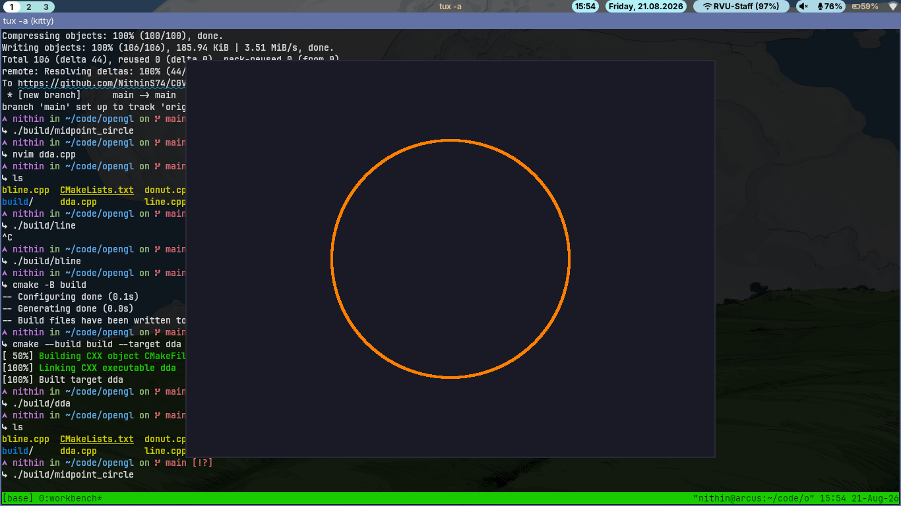
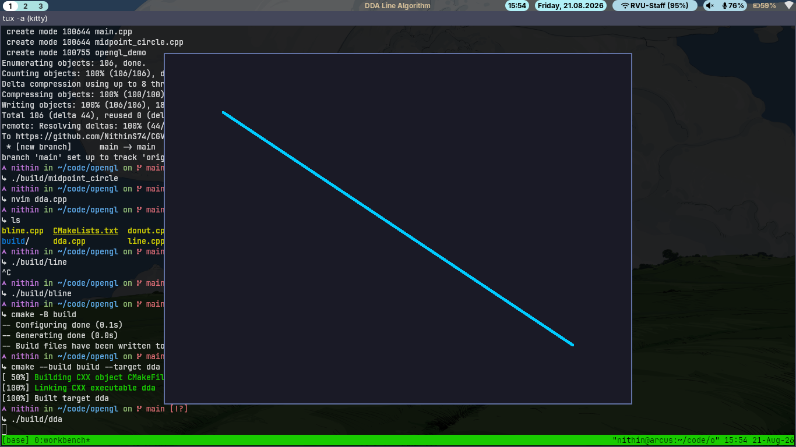
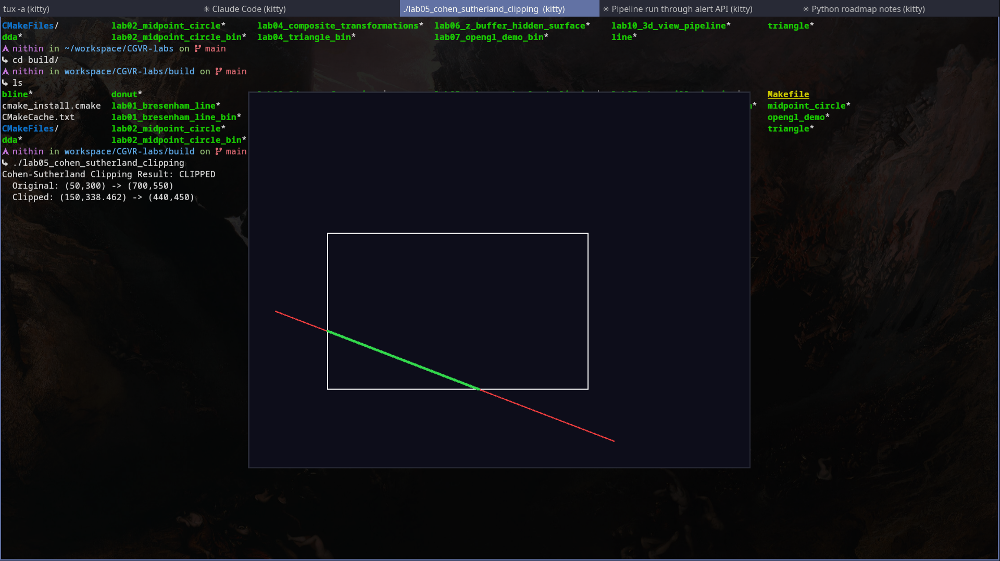
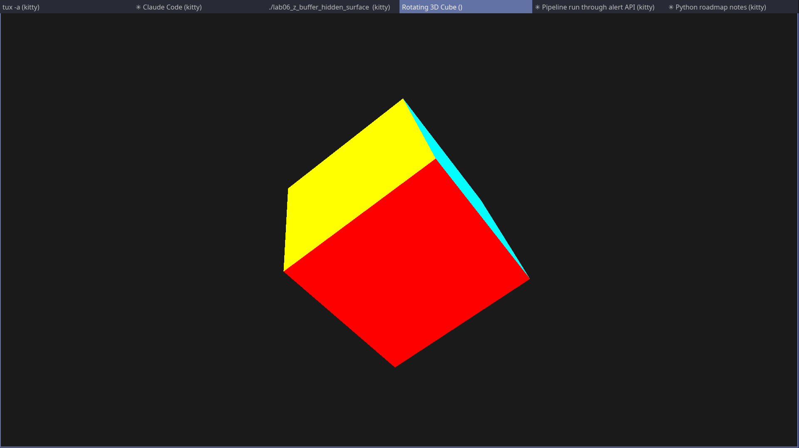
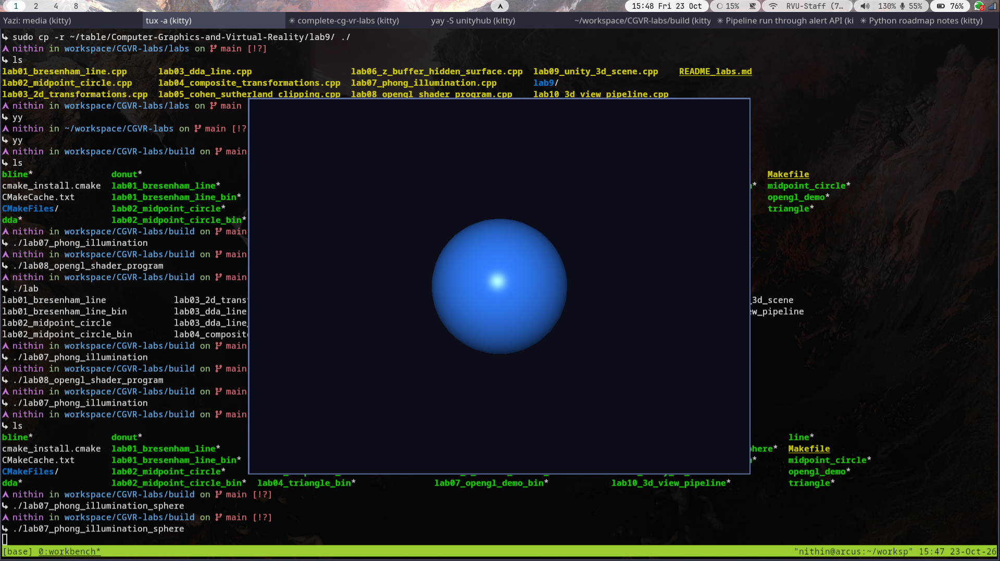
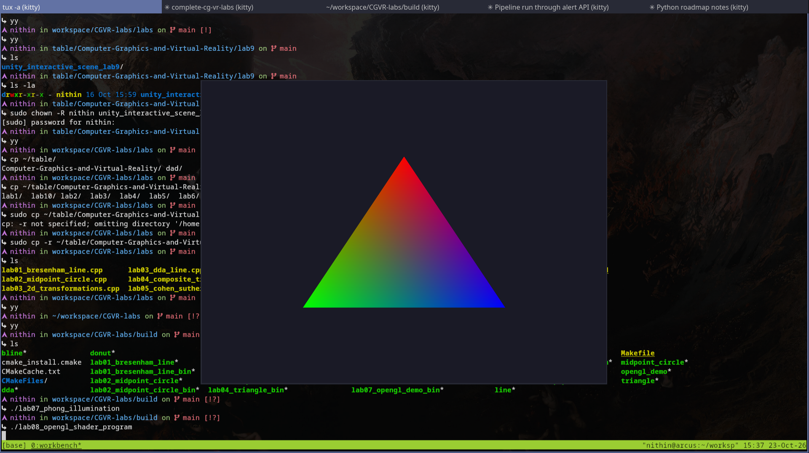
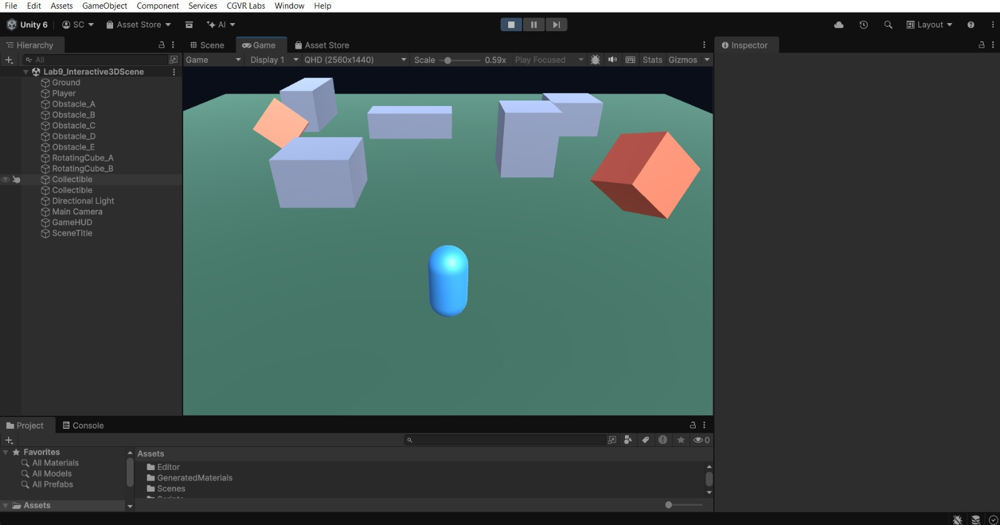

## Output

### 1. Implement DDA and Bresenham line drawing algorithms

### 2. Implement the Midpoint Circle Drawing Algorithm

### 3. Implement 2D transformations (translation, rotation, scaling, reflection and shearing) using homogeneous coordinates

### 4. Implement composite transformations using matrix representation

### 5. Implement the Cohen–Sutherland line clipping algorithm

### 6. Implement the Z-buffer algorithm for hidden surface removal

### 7. Implement the Phong illumination model for a 3D object

### 8. Develop a basic OpenGL program using vertex and fragment shaders

### 9. Create a simple interactive 3D scene using Unity

The Lab 9 folder contains the C# scripts and automatic scene builder for the interactive Unity scene. It demonstrates:

    player movement and jumping
    third-person camera follow
    obstacles and rotating objects
    collectible objects and score tracking
    directional lighting
    runtime HUD
    automatic scene generation

Unity version used: 6000.3.0f1.

### 10. To implement the 3D viewing pipeline, including projection and viewport mapping for displaying 3D objects on a 2D screen

